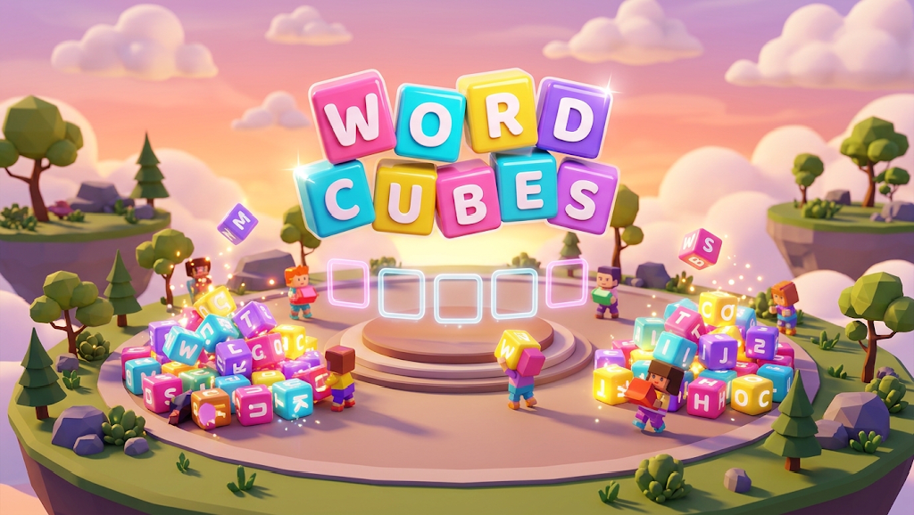

# Word Cubes



**Owner: RGL**

A cooperative word-hunting game for [Decentraland](https://decentraland.org), built with SDK7 and an authoritative Multiplayer Server.

Find the answer to a clue, dig through a pile of letter cubes, and carry and throw the right letters into the shared word. An incorrect letter makes the whole word collapse, so players have to rebuild together.

## Playing

Cubby teaches the basic controls in a solo tutorial. Public rooms support up to five players, with English, Spanish and Portuguese word banks. Players can earn coins, buy power-ups and vote on the next round's difficulty.

On desktop, click a cube to pick it up and a frame to place it. Press **E** to break a held cube or **F** to throw it away. Mobile uses touch controls.

## Development

Use Node.js 22 or newer.

```bash
npm install
npm run start
```

You can also open the project in the [Decentraland Creator Hub](https://decentraland.org/download/creator-hub) and press Play. Its Multi-Instance Preview option lets you test with multiple accounts.

```bash
npm run build          # Type-check and bundle the scene
node --test tests/*.test.cjs
```

Keep the SDK version configured in `package.json`: public games use the Multiplayer Server APIs.

## Project structure

- `src/index.ts`: scene entry point.
- `src/client/`: interactions, tutorial, rendering and UI.
- `src/server/`: public games, validation and saved profiles.
- `src/shared/`: shared data, messages and translations.
- `src/sim/`: cube physics.
- `src/config.ts`: gameplay and presentation settings.
- `assets/`: scene, models, images and audio.
- `scene.json`: scene metadata and deployment configuration.
- `tests/`: automated checks.

See [AGENTS.md](AGENTS.md) for coding assistant instructions and [the onboarding design](design/gdd.md) for the Cubby tutorial.
